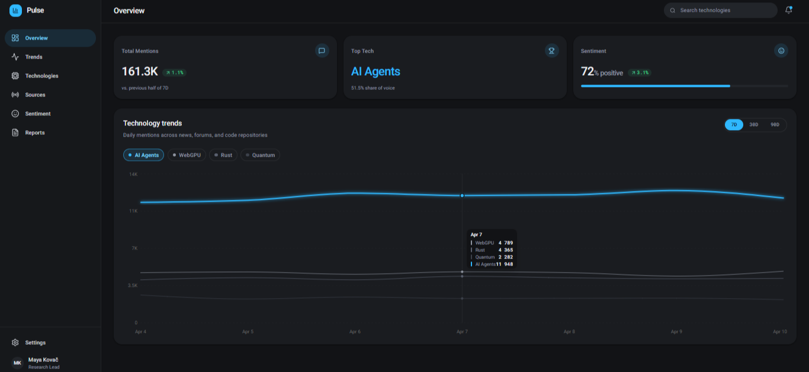
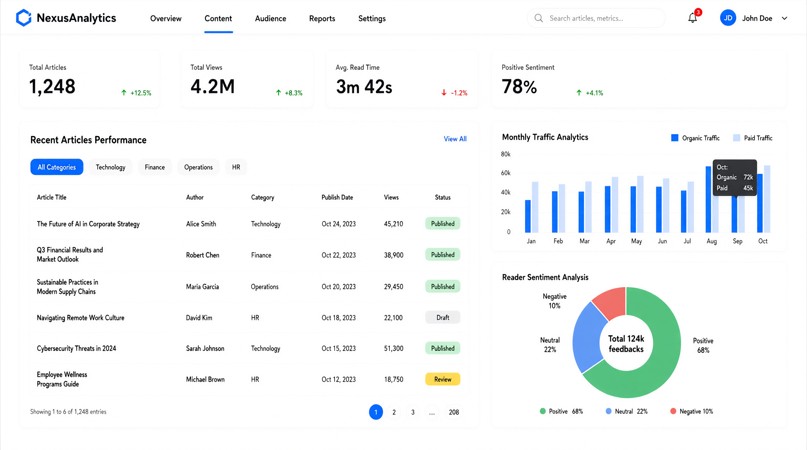
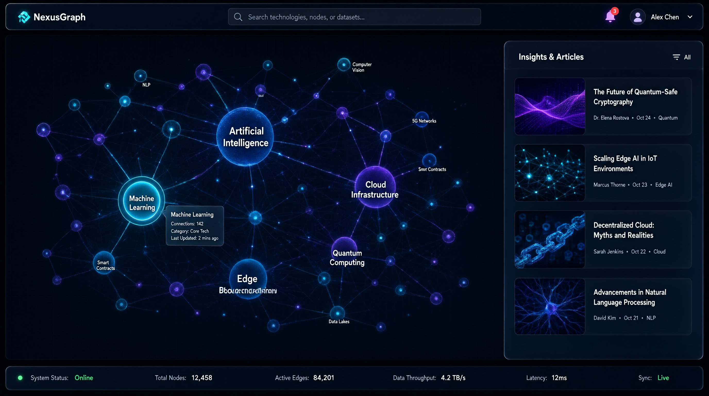

# ДЗ №3. UI-концепции и техническое задание TrendRadar

**Проект:** TrendRadar — аналитика технологических трендов на основе Hacker News  
**Стек:** React 18 + Vite, FastAPI, MongoDB, APScheduler, Ollama  
**Документ:** три UI-концепции, карта пользовательских историй и ТЗ для передачи AI-агенту

---

# Часть 1. UI-концепции

Перед финальной версией были проработаны три направления интерфейса. Все они используют общую навигацию (Dashboard, Explorer, Graph, Favorites, About) и работают с одними и теми же данными, но по-разному расставляют акценты.

## Концепция 1: Минимализм (Dark Mode)



### Что изображено

- Тёмная боковая панель шириной 240 px: логотип TrendRadar, пункты меню с иконками, переключатель темы и кнопка входа через GitHub внизу.
- Основная область: приветственный заголовок с датой, кнопки Refresh и Export CSV.
- Три KPI-карточки: Total Events, Top Technology, Sentiment Overview.
- Большой линейный график упоминаний выбранной технологии и круговая диаграмма тональности.
- Список последних статей с тегами технологий, рейтингом и количеством комментариев.

### Цвета и типографика

- Фон: `#0B1120`, поверхности: `#111827`, границы: `#1F2937`.
- Основной текст: `#F9FAFB`, вторичный: `#9CA3AF`.
- Акцент: `#3B82F6`, позитив: `#10B981`, негатив: `#EF4444`.
- Шрифт Inter, базовый размер 14–16 px, заголовки 24–30 px.

### Плюсы

- Данные находятся в центре внимания, интерфейс не перегружен.
- Тёмная тема снижает усталость глаз при длительной аналитике.
- Хорошо ложится на текущий Tailwind-код и класс `dark`.
- Легко масштабируется на новые карточки и графики.

### Минусы

- При неаккуратных контрастах текст и графики становятся плохо читаемыми.
- Выглядит привычно и не подчёркивает главную особенность проекта — граф связей.
- Тёмные палитры графиков нужно настраивать отдельно.
- Неудобно для печати и экспорта в светлые отчёты.

---

## Концепция 2: Аналитическая панель (Light, Data-Dense)



### Что изображено

- Светлая компоновка с верхней панелью фильтров: период, технология, тональность, категория.
- Пять компактных KPI-карточек в строку: всего статей, уникальных технологий, средний score, позитив, негатив.
- Таблица статей с сортировкой, мини-спарклайнами и цветовой индикацией тональности.
- Тепловая карта активности технологий по дням.
- Правая выдвижная панель с деталями выбранной статьи или технологии.

### Цвета и типографика

- Фон: `#F8FAFC`, карточки: `#FFFFFF`, границы: `#E2E8F0`.
- Основной текст: `#0F172A`, вторичный: `#64748B`.
- Акцент: `#4F46E5`, успех: `#059669`, ошибка: `#DC2626`.
- Плотная сетка, компактные отступы, табличные шрифты для чисел.

### Плюсы

- Максимальная информационная плотность: на экран помещается больше данных.
- Привычная BI-логика, удобно для аналитиков и работы с таблицами.
- Хорошо подходит для широких мониторов и печати.
- Проще проектировать сортировки, фильтры и массовые действия.

### Минусы

- Визуально тяжелее, чем минималистичный вариант.
- На мобильных устройствах таблицы требуют горизонтальной прокрутки или превращения в карточки.
- Меньше эмоциональной вовлечённости, интерфейс выглядит как обычная админка.
- Для тёмной темы потребуется отдельная проработка палитры.

---

## Концепция 3: Graph-First (Interactive Research Canvas)



### Что изображено

- Почти всё пространство экрана занимает интерактивный граф технологий на тёмном фоне.
- Узлы — технологии, размер узла зависит от числа упоминаний, цвет — от категории.
- Связи — совместные упоминания в статьях; толщина линии показывает частоту.
- Плавающая верхняя панель: поиск технологии, фильтр категорий, переключатель темы.
- Правая выдвижная панель: карточка выбранной технологии, количество упоминаний и последние статьи.
- Внизу — компактная строка статистики: всего узлов, связей, статей.

### Цвета и типографика

- Фон: `#070B14`, рабочее поле графа: `#0B1220`.
- Пастельные категории: AI — `#93C5FD`, Web — `#86EFAC`, Python — `#FDE047`, Database — `#C4B5FD`, DevOps — `#FDBA74`, Mobile — `#F9A8D4`, Cloud — `#67E8F9`, Security — `#FCA5A5`, Hardware — `#D1D5DB`, Networking — `#5EEAD4`.
- Крупные подписи узлов, полупрозрачные панели, минимум визуального шума.

### Плюсы

- Главная ценность продукта — связи между технологиями — выходит на первый план.
- Сильный визуальный образ, который отличает TrendRadar от обычных дашбордов.
- Поддерживает исследовательский сценарий: клик по узлу → статьи → новая гипотеза.
- Хорошо работает с уже реализованным `vis-network`.

### Минусы

- При большом числе узлов граф превращается в «волосяной шар».
- Сложнее обеспечить доступность и управление с клавиатуры.
- На мобильных устройствах граф требует упрощённого режима или списка.
- Нужны ограничения по количеству узлов и фильтры, иначе падает производительность.

---

## Обоснование выбора

Для финальной версии выбран **гибрид Концепции 1 и Концепции 3**: минималистичная тёмная оболочка с боковой навигацией и акцентом на интерактивный граф.

Почему именно такой гибрид:

1. **Аналитика — основной сценарий.** Пользователь приходит смотреть тренды и связи, а не заполнять формы. Тёмная минималистичная оболочка убирает визуальный шум и оставляет данные.
2. **Граф — ключевая дифференциация.** Концепция 3 делает граф центральным элементом, но в чистом виде он неудобен для навигации и сводных показателей. Боковая панель и KPI-карточки из Концепции 1 возвращают пользователю ориентацию.
3. **Единый визуальный язык.** Тёмный фон, синий акцент и пастельные категории графа хорошо сочетаются и не требуют двух разных дизайн-систем.
4. **Длительная работа.** Тёмная тема комфортнее для аналитических сессий; при этом сохраняется светлая тема для печати и презентаций.
5. **Практичность реализации.** Текущий frontend уже использует Tailwind, `dark`-класс, `recharts`, `chart.js` и `vis-network`, поэтому гибрид не требует смены технологического стека.

**Финальная компоновка:** тёмная тема по умолчанию, левое меню, Dashboard с KPI и графиками, Explorer с поиском и карточками, Graph с полноэкранным полотном и правой панелью деталей, Favorites со списком сохранённых статей.

---

# Часть 2. User Story Mapping

## Персоны

- **Аналитик** — авторизованный пользователь, который следит за технологическими трендами и сохраняет материалы.
- **Гость** — пользователь без авторизации: может смотреть публичные данные, но не может управлять персональным избранным.
- **Исследователь / студент** — изучает связи между технологиями и выгружает данные для отчётов.

## Карта историй

| Этап | Действие пользователя | Истории |
| --- | --- | --- |
| 1. Вход | Авторизоваться через GitHub | US-01 |
| 2. Обзор | Посмотреть сводку трендов | US-02 |
| 3. Поиск | Найти статьи по теме | US-03 |
| 4. Исследование | Посмотреть граф связей | US-04 |
| 5. Сохранение | Добавить материал в избранное | US-05 |
| 6. Настройка | Переключить тему | US-06 |
| 7. Экспорт | Выгрузить статьи в CSV | US-07 |

## Список историй и приоритеты

| ID | История | Приоритет |
| --- | --- | --- |
| US-01 | Как аналитик, я хочу войти через GitHub, чтобы сохранять избранное и видеть персональные данные. | Must have |
| US-02 | Как аналитик, я хочу видеть дашборд с ключевыми трендами, чтобы быстро оценить общую картину. | Must have |
| US-03 | Как исследователь, я хочу искать и фильтровать статьи в Explorer, чтобы находить материалы по нужной технологии. | Must have |
| US-04 | Как аналитик, я хочу видеть граф связей технологий, чтобы находить неочевидные комбинации и тренды. | Must have |
| US-05 | Как аналитик, я хочу добавлять технологию в избранное из карточки статьи, чтобы возвращаться к интересным материалам. | Must have |
| US-06 | Как пользователь, я хочу переключать светлую и тёмную тему, чтобы работать в комфортном режиме. | Should have |
| US-07 | Как исследователь, я хочу экспортировать статьи в CSV, чтобы использовать данные в отчёте. | Should have |
| US-08 | Как пользователь, я хочу видеть скрытые жемчужины — недооценённые статьи с высоким рейтингом и малым обсуждением. | Should have |
| US-09 | Как пользователь, я хочу получать краткое AI-саммари статьи одной кнопкой. | Should have |
| US-10 | Как администратор, я хочу видеть статистику коллектора и очищать базу по ключу. | Should have |
| US-11 | Как пользователь, я хочу подписываться на технологии и видеть счётчик новых статей. | Should have |
| US-12 | Как пользователь, я хочу сравнивать популярность 2–4 технологий на одном графике. | Should have |
| US-13 | Как пользователь, я хочу листать результаты поиска дальше первой страницы («Загрузить ещё»). | Should have |
| US-14 | Как аналитик, я хочу видеть статьи из двух источников (Hacker News и Dev.to) и их соотношение. | Should have |
| US-15 | Как пользователь, я хочу получать умную ленту «Для вас» — статьи моих технологий первыми. | Should have |
| US-16 | Как пользователь, я хочу, чтобы граф был красивым и работал в тёмной теме. | Could have |

> **Уточнение по US-05:** в текущей модели «избранное» хранит статью, а технологии отображаются как её теги. Поэтому сохранение технологии выполняется через сохранение статьи, в которой она упоминается; в карточке избранного технология остаётся видимой.

## Критерии приёмки

### US-01. Вход через GitHub

- **AC-01 (позитивный):** **Given** пользователь не авторизован, **When** он нажимает «Sign in with GitHub» и подтверждает доступ, **Then** backend выполняет OAuth-обмен, возвращает JWT, фронтенд сохраняет токен и запрос `GET /api/auth/me` показывает username и avatar.
- **AC-02 (негативный):** **Given** пользователь отклонил доступ на GitHub, **When** происходит возврат в приложение, **Then** токен не сохраняется, показывается сообщение «Не удалось войти», пользователь остаётся гостем.
- **AC-03 (негативный):** **Given** токен истёк или повреждён, **When** приложение запрашивает защищённый ресурс, **Then** приходит `401`, токен удаляется, интерфейс предлагает войти заново.

### US-02. Дашборд с трендами

- **AC-01 (позитивный):** **Given** в базе есть статьи с `score > 100` и `descendants < 5`, **When** пользователь открывает `/`, **Then** отображаются Total Events, Top Technology, Sentiment Overview, виджет «💎 Скрытые жемчужины» (топ-3 по рейтингу через `GET /api/trends/hidden-gems`), график timeline и последние статьи выбранной технологии.
- **AC-02 (позитивный):** **Given** дашборд загружен, **When** пользователь выбирает другую технологию в селекторе, **Then** график и список статей обновляются без полной перезагрузки страницы.
- **AC-03 (негативный):** **Given** backend недоступен, **When** страница пытается загрузить данные, **Then** показывается понятный error-banner с кнопкой Retry, а не бесконечный спиннер.
- **AC-04 (негативный):** **Given** база пуста или подходящих статей нет, **When** дашборд открывается, **Then** счётчики показывают `0`, виджет жемчужин показывает empty-state, графики — пустое состояние «No data», интерфейс не падает.

### US-03. Поиск статей в Explorer

- **AC-01 (позитивный):** **Given** загружено 500 статей, **When** пользователь вводит запрос в поиск, **Then** список запрашивается у `GET /api/trends/search?q=&technology=&sort_by=&limit=50` и фильтруется по вхождению в заголовок без учёта регистра, а счётчик «Found» обновляется.
- **AC-02 (позитивный):** **Given** выбрана технология и введён поисковый запрос, **When** применяются оба фильтра, **Then** показываются только статьи, удовлетворяющие обоим условиям; сортировка по дате, score или комментариям выполняется на бэкенде (`sort_by=date|score|comments`) и обновляет список при смене select.
- **AC-03 (негативный):** **Given** по фильтрам ничего не найдено, **When** список пуст, **Then** показывается empty state с подсказкой изменить фильтры и кнопкой «Clear filters».
- **AC-04 (негативный):** **Given** запрос статей завершился ошибкой, **When** Explorer загружается, **Then** показывается сообщение об ошибке и кнопка Retry; ранее введённые фильтры не сбрасываются.

### US-04. Просмотр графа связей

- **AC-01 (позитивный):** **Given** в базе есть технологии с совместными упоминаниями, **When** пользователь открывает `/graph`, **Then** отображаются узлы, связи, легенда категорий и общее число узлов и связей.
- **AC-02 (позитивный):** **Given** граф загружен, **When** пользователь кликает по узлу технологии, **Then** открывается боковая панель и загружаются последние статьи через `GET /api/trends/{technology}/articles?limit=10`.
- **AC-03 (негативный):** **Given** API графа вернул ошибку, **When** страница открывается, **Then** показывается error state с Retry, а не пустой белый экран.
- **AC-04 (негативный):** **Given** данных недостаточно и узлов нет, **When** граф строится, **Then** показывается empty state «Недостаточно данных для графа», легенда и панель не ломаются.

### US-05. Добавление технологии в Избранное

- **AC-01 (позитивный):** **Given** авторизованный пользователь видит статью с технологией, **When** он нажимает на сердечко, **Then** выполняется `POST /api/favorites` c Bearer JWT и `article_id`, `title`, `url`, `score`, `technologies`, сердечко становится активным, а запись появляется в личном кабинете.
- **AC-02 (позитивный):** **Given** статья уже в избранном, **When** пользователь нажимает на активное сердечко, **Then** выполняется `DELETE /api/favorites/{article_id}` (только своя запись), сердечко становится неактивным, запись исчезает из личного кабинета.
- **AC-03 (негативный):** **Given** повторный `POST` вернул `400 Already in favorites`, **When** пользователь добавляет ту же статью, **Then** интерфейс сохраняет активное состояние без дубликата в БД (уникальная пара `user_key + article_id`).
- **AC-04 (негативный):** **Given** пользователь не авторизован, **When** он открывает `/favorites`, **Then** показывается экран «Требуется вход» с кнопкой входа через GitHub; пункт «Личный кабинет» в меню скрыт, сердечки в карточках не отображаются.
- **AC-05 (негативный):** **Given** в избранном нет записей, **When** пользователь открывает Favorites, **Then** показывается empty state с объяснением, как добавить первую статью.
- **AC-06 (негативный):** **Given** JWT протух, **When** запрос избранного вернул `401`, **Then** токен сбрасывается и страница показывает экран входа.

### US-06. Переключение темы

- **AC-01 (позитивный):** **Given** приложение открыто, **When** пользователь нажимает «Dark Mode», **Then** на корневой элемент добавляется класс `dark`, цвета интерфейса и графиков меняются, выбор сохраняется в `localStorage`.
- **AC-02 (позитивный):** **Given** ранее была выбрана тёмная тема, **When** приложение загружается повторно, **Then** тёмная тема применяется сразу, без заметного мигания светлой.
- **AC-03 (негативный):** **Given** `localStorage` недоступен, **When** пользователь переключает тему, **Then** тема меняется в текущей сессии, а ошибка сохранения не блокирует интерфейс.

### US-07. Экспорт статей в CSV

- **AC-01 (позитивный):** **Given** на дашборде загружены статьи, **When** пользователь нажимает Export CSV, **Then** скачивается файл `trendradar_{technology}_{timestamp}.csv` с колонками Title, Score, Comments, Date, URL, Technologies.
- **AC-02 (позитивный):** **Given** в заголовке статьи есть кавычки или запятые, **When** формируется CSV, **Then** значения экранируются и файл открывается без сдвига колонок.
- **AC-03 (негативный):** **Given** статей нет, **When** пользователь нажимает Export CSV, **Then** экспорт не создаёт пустой файл, а показывает сообщение «Нет данных для экспорта».

### US-11. Подписки на технологии

- **AC-01 (позитивный):** **Given** пользователь выбрал технологию в Explorer, **When** он нажимает 🔔 «Следить», **Then** выполняется `POST /api/subscriptions` с Bearer JWT, кнопка меняется на «Не следить», подписка появляется в личном кабинете.
- **AC-02 (позитивный):** **Given** у подписки есть новые статьи (`created_at > last_seen_at`), **When** пользователь открывает кабинет, **Then** рядом с технологией показан бейдж «+N новых», кнопка «Отметить прочитанным» (`POST .../visit`) сбрасывает счётчик.
- **AC-03 (позитивный):** **Given** подписка существует, **When** пользователь нажимает «Отписаться», **Then** выполняется `DELETE /api/subscriptions/{technology}` и строка исчезает.
- **AC-04 (негативный):** **Given** пользователь не авторизован, **When** он открывает Explorer, **Then** кнопки подписки не отображаются; `POST /api/subscriptions` без JWT возвращает `401`.
- **AC-05 (негативный):** **Given** повторная подписка на ту же технологию, **When** выполняется `POST`, **Then** бэкенд возвращает `409 Already subscribed`, состояние интерфейса не ломается.

### US-12. Сравнение технологий

- **AC-01 (позитивный):** **Given** пользователь выбрал 2–4 технологии на `/compare`, **When** страница загружается, **Then** `GET /api/trends/compare?tech=A,B&days=N` рисует один график Recharts с линией на каждую технологию и легендой.
- **AC-02 (позитивный):** **Given** выбран период 7/14/30/90 дней, **When** пользователь меняет select, **Then** график перезапрашивается, пропущенные даты заполняются нулями (линии непрерывные).
- **AC-03 (негативный):** **Given** выбрано уже 4 технологии, **When** пользователь пытается добавить пятую, **Then** чипы заблокированы (`Выбрано: 4/4`).
- **AC-04 (негативный):** **Given** за период нет данных, **When** график строится, **Then** показывается empty-state «Нет данных за выбранный период».

### US-13. Пагинация в Explorer

- **AC-01 (позитивный):** **Given** под запрос подходит больше 25 статей, **When** Explorer загружается, **Then** показываются первые 25 и кнопка «📄 Загрузить ещё (N осталось)».
- **AC-02 (позитивный):** **Given** кнопка нажата, **When** выполняется запрос с `skip=25`, **Then** статьи добавляются к списку без сброса фильтров и счётчик «X of Y» обновляется.
- **AC-03 (негативный):** **Given** все статьи загружены, **When** `items.length === total`, **Then** кнопка «Загрузить ещё» скрывается.
- **AC-04 (негативный):** **Given** backend недоступен, **When** загрузка идёт, **Then** показывается error-баннер, список не обнуляется.

### US-14. Второй источник Dev.to

- **AC-01 (позитивный):** **Given** collector запущен, **When** выполняется плановый/первичный сбор, **Then** статьи с Dev.to сохраняются с `source: "devto"` и проходят тот же AI-анализ технологий.
- **AC-02 (позитивный):** **Given** в базе есть статьи обоих источников, **When** админ открывает `/admin`, **Then** таблица источников показывает числа по HN и Dev.to (по полю `source`, fallback — домен url).
- **AC-03 (негативный):** **Given** Dev.to API недоступен, **When** collector выполняет сбор, **Then** ошибка логируется, сбор Hacker News не прерывается, сервис продолжает работу.

### US-15. Умная лента «Для вас»

- **AC-01 (позитивный):** **Given** авторизованный пользователь с подписками открывает Dashboard, **When** страница загружается, **Then** появляется блок «🤖 Для вас» со статьями подписанных технологий вверху (`GET /api/feed`) и бейджами персонального рейтинга.
- **AC-02 (позитивный):** **Given** формула ранжирования, **When** две статьи имеют одинаковые технологии, **Then** выше стоит более свежая и с большим score (вес подписки 30, «новое после визита» +20, технологии из избранного +10, свежесть до +20, HN-score × 0.01).
- **AC-03 (негативный):** **Given** пользователь не авторизован, **When** открывается Dashboard, **Then** блок ленты не показывается (публичный Dashboard не меняется).
- **AC-04 (негативный):** **Given** пользователь авторизован, но без подписок, **When** лента загружается, **Then** показывается подсказка «Подпишитесь на технологии в Explorer».

### US-16. Визуализация графа

- **AC-01 (позитивный):** **Given** включена тёмная тема, **When** открывается Graph, **Then** контейнер с градиентным тёмным фоном, светлые подписи узлов, неоновые рёбра; карточка страницы — `dark:bg-gray-800`.
- **AC-02 (позитивный):** **Given** переключение темы на странице графа, **When** `darkMode` меняется, **Then** граф перестраивается с новой палитрой (эффект зависит от `darkMode`).
- **AC-03 (позитивный):** **Given** рёбра с разным числом совместных упоминаний, **When** граф рендерится, **Then** толщина линии пропорциональна силе связи.
- **AC-04 (негативный):** **Given** удалена дублирующая легенда сверху, **When** пользователь ищет категории, **Then** они подписаны прямо на кластерных узлах.

---

# Часть 3. Техническое задание (ТЗ)

## 3.1. Описание проекта

TrendRadar — веб-приложение для мониторинга и анализа технологических трендов по материалам Hacker News.

Поток данных:

```text
Hacker News Firebase API
        │
        ▼
collector/ (httpx + Ollama + APScheduler)
        │  извлекает технологии, тональность, категорию
        ▼
MongoDB (trendradar)
        │
        ▼
backend/ (FastAPI + Motor) ── REST API /api/*
        │
        ▼
frontend/ (React 18 + Vite + Tailwind)
```

### Компоненты

- **Collector** — периодически загружает топ-статьи Hacker News и Dev.to, анализирует заголовки через локальную Ollama, фильтрует статьи без технологий и сохраняет результаты в MongoDB с пометкой источника (`source`). Первичный сбор — до 300 статей, далее по 50 каждые 5 минут.
- **Backend** — FastAPI-приложение. Отдаёт сводку трендов, статьи и timeline по технологиям, граф связей, избранное и авторизацию. Доступ к MongoDB — асинхронный, через Motor.
- **Database** — MongoDB, база `trendradar`. Основные коллекции: `trend_events`, `favorites`, `users`.
- **Frontend** — SPA на React 18 и Vite. Страницы: Dashboard, Explorer, Graph, Favorites (личный кабинет, после входа), AuthCallback, About, Admin (вне меню).

### Модель данных

| Коллекция | Ключевые поля |
| --- | --- |
| `trend_events` | `id` (уникальный HN id), `title`, `url`, `score`, `descendants`, `created_at`, `technologies[]`, `sentiment`, `category` |
| `favorites` | `article_id` (уникальный), `title`, `url`, `score`, `technologies[]`, `added_at`, `user_id` (целевое поле) |
| `users` | `github_id` (уникальный), `username`, `avatar_url`, `email`, `weekly_digest` |

## 3.2. Целевая аудитория

- **Аналитики и технологические эксперты** — отслеживают, какие технологии набирают упоминания, и ищут связи между направлениями.
- **Разработчики и тимлиды** — выбирают стек, следят за инструментами и сохраняют полезные статьи.
- **Студенты и исследователи** — изучают тренды, готовят обзоры и выгружают данные в CSV.
- **Читатели Hacker News** — хотят видеть агрегированную картину вместо ручного просмотра ленты.

Роли:

- **Гость** — просмотр дашборда, Explorer и графа; избранное недоступно.
- **Авторизованный пользователь** — всё вышеперечисленное плюс персональное избранное.
- **Администратор** — отдельная роль в MVP не предусмотрена.

## 3.3. Функциональные требования по экранам

### 3.3.1. Dashboard (`/`)

**Назначение:** дать общую картину трендов за всё время и по выбранной технологии.

**Элементы:**

- Заголовок с текущей датой.
- Кнопки Refresh и Export CSV.
- KPI-карточки: Total Events, Top Technology + количество упоминаний, Sentiment Overview (positive / neutral / negative).
- Линейный график упоминаний выбранной технологии по дням.
- Список последних статей с рейтингом, комментариями, датой, тегами технологий и ссылкой.
- Селектор технологии: AI, Web, Python, Database, DevOps, Mobile, Cloud, Security, Hardware.

**Источники данных:**

| Данные | Endpoint |
| --- | --- |
| Сводка, топ-технология, тональность | `GET /api/trends/summary` |
| Timeline выбранной технологии | `GET /api/trends/{technology}/timeline` |
| Последние статьи технологии | `GET /api/trends/{technology}/articles?limit=5` |
| Статус избранного для статей | `GET /api/favorites/check/{article_id}` |

**Поведение:**

- При загрузке сначала запрашивается summary; топ-технология становится выбранной по умолчанию.
- При смене технологии timeline и статьи обновляются без перезагрузки страницы.
- Refresh повторяет загрузку и показывает состояние обновления.
- Export CSV формируется на клиенте из текущего списка статей.
- Сердечко в списке статей вызывает `POST` или `DELETE /api/favorites` и обновляет локальное состояние.

**Состояния:** skeleton-загрузка, error-banner с Retry, пустые графики с текстом «No data», пустой список статей.

### 3.3.2. Explorer (`/explorer`)

**Назначение:** найти конкретные статьи по названию и технологии, отсортировать и сохранить.

**Элементы:**

- Заголовок и счётчик собранных статей.
- Поле поиска по заголовку.
- Селектор технологии (все или одна из 10 категорий).
- Сортировка: дата (новые), score (высокие), комментарии (больше), название (A–Z).
- Счётчик найденных статей и кнопка Clear filters.
- Карточки статей с тегами, рейтингом, комментариями, датой, ссылкой и сердечком.
- Кнопка Refresh.

**Источники данных:**

- В текущей реализации статьи загружаются параллельно по каждой из 10 технологий: `GET /api/trends/{technology}/articles?limit=50`, затем дубликаты удаляются по `id`.
- Поиск, фильтрация и сортировка выполняются на клиенте.
- Статус избранного — `GET /api/favorites/check/{article_id}`.

**Целевое улучшение (для AI-агента):** при росте данных добавить серверный endpoint `GET /api/articles?search=&technology=&sort=&limit=&skip=`, чтобы не делать 10 запросов и не держать все статьи в памяти. На первом этапе допустима текущая клиентская реализация.

**Состояния:** загрузка, ошибка с Retry, «No articles found» с предложением изменить фильтры.

### 3.3.3. Graph (`/graph`)

**Назначение:** исследовать связи технологий и переходить от узла к статьям.

**Элементы:**

- Полотно графа (`vis-network`) с узлами-технологиями и связями.
- Размер узла зависит от числа упоминаний, цвет — от категории.
- Кластеризация узлов по атрибуту `group` (категории технологий).
- Связи co-occurrence: технологии, встречающиеся в одной статье.
- Иерархические связи из `TECH_HIERARCHY` отображаются пунктиром.
- Легенда категорий.
- Счётчики Technologies и Connections.
- Правая панель с последними статьями выбранной технологии.
- Блок «Похожие технологии» с топ-3 рекомендациями.
- Подсказка: drag, zoom, click, double-click по кластеру.

**Источники данных:**

| Данные | Endpoint |
| --- | --- |
| Узлы и связи графа | `GET /api/graph` |
| Статьи выбранного узла | `GET /api/trends/{technology}/articles?limit=10` |
| Похожие технологии | `GET /api/trends/similar/{technology}?limit=3` |

**Поведение:**

- При клике по узлу открывается панель, загружаются статьи; при клике по пустому месту панель закрывается и приглушение сбрасывается.
- Узлы одной категории собираются в кластер; двойной клик по кластеру раскрывает его, клик по бейджу похожей технологии открывает содержащий её кластер и фокусирует узел.
- Остальные узлы и связи приглушаются до `opacity: 0.2`, выбранный узел остаётся полностью непрозрачным.
- После стабилизации физика отключается, чтобы граф не двигался при изучении.
- Граф поддерживает перетаскивание узлов, масштабирование и hover-подсказки.
- При большом числе узлов показывать не более 200 узлов; при превышении — фильтр по категории или топ-N по упоминаниям.

**Состояния:** загрузка, ошибка с Retry, пустой граф с объяснением, отсутствие статей у выбранного узла.

### 3.3.4. Favorites (`/favorites`)

**Назначение:** хранить статьи (и связанные технологии), к которым пользователь хочет вернуться.

**Элементы:**

- Заголовок «My Favorites».
- Список сохранённых статей: название, score, дата добавления, теги технологий, ссылка.
- Кнопка удаления (активное сердечко).
- Empty state с объяснением, как добавить первую статью.

**Источники данных:**

| Действие | Endpoint |
| --- | --- |
| Получить избранное | `GET /api/favorites` |
| Добавить статью | `POST /api/favorites` |
| Удалить статью | `DELETE /api/favorites/{article_id}` |
| Проверить статус | `GET /api/favorites/check/{article_id}` |

**Важно для реализации:** сейчас API избранного не привязан к пользователю и не требует JWT. В целевой версии каждая запись должна содержать `user_id`, а backend — проверять `Authorization: Bearer <JWT>` и возвращать только избранное текущего пользователя. Для гостя операции добавления и удаления должны возвращать `401`.

**Состояния:** загрузка, ошибка, пустой список, ошибка удаления с сохранением элемента в списке.

### 3.3.5. Общие элементы

- Боковая навигация с активным пунктом меню.
- Переключатель темы.
- Кнопка входа через GitHub / отображение пользователя.
- Единые карточки, отступы, скругления и типографика.
- Уведомления об успехе и ошибке для действий с избранным.

## 3.4. Нефункциональные требования

### Стек

- **Frontend:** React 18, Vite, Tailwind CSS (CDN), `recharts`, `chart.js` + `react-chartjs-2`, `vis-network` + `vis-data`.
- **Backend:** Python 3.10+, FastAPI, Motor, Pydantic, `httpx`, `python-jose`.
- **Database:** MongoDB, база `trendradar`.
- **Collector:** Python, `httpx`, APScheduler, Ollama.
- **Формат API:** JSON, REST, префикс `/api`.

### Безопасность

- Авторизация — GitHub OAuth; после callback backend выдаёт JWT (HS256, срок 30 дней).
- JWT передаётся в заголовке `Authorization: Bearer <token>`; для защищённых операций backend проверяет подпись и срок.
- Секреты (`GITHUB_CLIENT_ID`, `GITHUB_CLIENT_SECRET`, `JWT_SECRET`, строки подключения) хранятся только в `.env`; запрещено хардкодить их в коде и конфигурации фронтенда.
- CORS разрешает только доверенные origins (в разработке — `http://localhost:5173`); при использовании credentials нельзя ставить `*`.
- Входные данные валидируются через Pydantic; ошибки возвращаются через `HTTPException` с корректным статусом.
- Токены и секреты не логируются. Для production рекомендуется HTTPS и httpOnly-cookie вместо `localStorage`.
- Деструктивные операции с БД выполняются только вручную и с подтверждением.

### Адаптивность

- Основной сценарий — desktop от 1280 px; поддерживать 1024 px и 768 px.
- На планшете боковая панель сворачивается в иконки или верхнее меню.
- На мобильном карточки и таблицы превращаются в вертикальный список; граф получает упрощённый режим или предупреждение о размере экрана.
- Графики имеют `min-height` и не ломают сетку при отсутствии данных.
- Все интерактивные элементы доступны с клавиатуры; контраст текста не ниже 4.5:1.

### Производительность

- Первичная загрузка Dashboard — до 2 секунд на локальных данных.
- Поиск в Explorer debounce 300 мс; фильтрация не должна блокировать ввод.
- Граф лениво инициализируется после загрузки данных; при большом объёме — ограничение узлов.
- Списки статей используют `limit`; для больших выборок предусмотреть пагинацию.
- API не должен возвращать весь `_id` MongoDB; сериализация дат — ISO 8601.

### Совместимость и качество

- Браузеры: Chrome, Edge, Firefox, Safari (последние две версии).
- Код frontend — функциональные компоненты и хуки, без классовых компонентов.
- В финальном коде не должно быть `console.log`, `var`, хардкода секретов.
- Сборка frontend проверяется командой `npm run build`; backend запускается через `uvicorn main:app --reload --port 8000` из папки `backend/`.

### Текущие ограничения репозитория

- В `frontend/package.json` отсутствуют импортируемые `react-router-dom` и `recharts`; перед сборкой их нужно добавить.
- Автоматических тестов, линтера и CI в проекте нет; проверка выполняется вручную.
- Избранное сейчас глобальное; привязка к пользователю — обязательное требование целевой версии.

## 3.5. Обработка ошибок и edge cases

| Ситуация | Ожидаемое поведение |
| --- | --- |
| **API недоступен / 5xx** | Показать error-banner с понятным текстом и кнопкой Retry; не оставлять бесконечный spinner; залогировать ошибку на клиенте через `console.error`. |
| **Сетевой timeout** | Показать «Сервер не отвечает. Попробуйте ещё раз»; Retry повторяет только неудавшийся запрос. |
| **База пуста** | Счётчики `0`, графики и списки — empty state «No data»; предложить запустить collector. Не показывать вымышленные данные. |
| **Нет результатов поиска** | Empty state «No articles found» с кнопкой Clear filters; сохранить введённый запрос, чтобы пользователь мог его исправить. |
| **Пользователь не авторизован** | Просмотр публичных экранов доступен; при попытке добавить в избранное — предложение войти, без изменения локального состояния. |
| **JWT истёк / невалиден** | `401` → удалить токен, показать сообщение «Сессия истекла», предложить повторный вход. |
| **Повторное добавление в избранное** | `400 Already in favorites` → не создавать дубликат, оставить сердечко активным, показать уведомление. |
| **Удаление несуществующей записи** | `404` → убрать элемент из локального списка и показать нейтральное уведомление. |
| **Технология не найдена** | `404` или пустой массив → показать «Для этой технологии пока нет статей», не ломать график. |
| **Граф пуст** | Показать empty state «Недостаточно данных для графа»; легенда и панель остаются работоспособными. |
| **Слишком много узлов графа** | Ограничить топ-N (например, 200) по упоминаниям, показать подсказку про фильтр; не блокировать браузер. |
| **MongoDB недоступна** | Backend возвращает `503` с безопасным сообщением; collector логирует ошибку и повторяет попытку позже. |
| **Ollama недоступна** | Collector использует fallback-режим без LLM или пропускает анализ; статья без технологий не сохраняется. |
| **CSV без данных** | Не создавать пустой файл; показать «Нет данных для экспорта» и оставить кнопку неактивной. |
| **Длинные заголовки и спецсимволы** | Обрезать визуально, но сохранять полный текст в `title`; экранировать кавычки и запятые в CSV. |
| **CORS-ошибка** | Проверить origin и порт frontend; в разработке фиксировать Vite на 5173 через `strictPort`; не отключать проверку origin. |

## 3.6. Границы задачи (anti-scope)

В рамках текущей версии не требуется:

- отдельное мобильное приложение или PWA;
- административная панель управления пользователями;
- real-time обновления через WebSocket;
- обучение собственной ML-модели;
- платные внешние API и облачные очереди;
- полноценная система ролей и прав, кроме «гость / авторизованный пользователь».

## 3.7. Инструкция для AI-агента

При генерации кода по этому ТЗ:

1. Сначала прочитать `AGENTS.md` и существующие страницы, не дублировать уже реализованные компоненты.
2. Сохранять текущие контракты API; новые поля добавлять обратносовместимо.
3. Использовать функциональные компоненты, Tailwind и существующие библиотеки; не добавлять зависимости без необходимости.
4. Для каждой страницы реализовать состояния loading, empty, error и unauthorized.
5. Проверить сборку `npm run build` и запуск backend; перечислить изменённые файлы и команды проверки.
